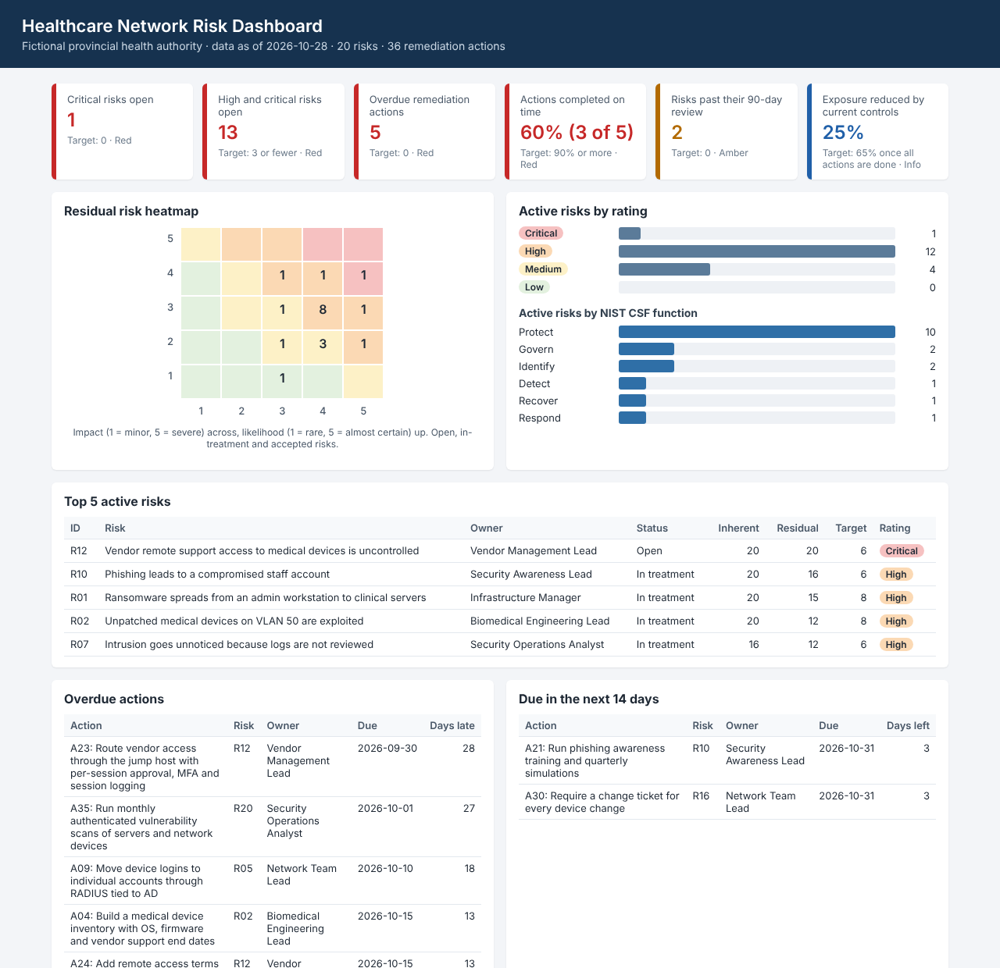

# Healthcare Network Risk Assessment

Threat and risk assessment (TRA) of the network from my [healthcare-network-design](https://github.com/manthanray03/healthcare-network-design) project: a fictional provincial health authority with 1 data centre, 2 hospitals and 5 rural clinics. It includes a risk register mapped to NIST CSF 2.0 and ISO/IEC 27001:2022, remediation tracking with owners and due dates, a third-party vendor assessment, and Python and SQL scripts that check the register and build a key risk indicator (KRI) dashboard.

Scope note: This is a learning project. The organization, vendor, people and findings are fictional, and owners are job roles, not real people. No penetration testing or scanning was done; the assessment is based on the design documents and configs in the network design repository.

## Results at a glance

| | |
|---|---|
| Risks assessed | 20 (17 active, 2 accepted, 1 closed) |
| Active risks rated High or Critical | 13 of 17 |
| Critical | 1: vendor remote access to medical devices (R12) |
| Remediation actions | 36, with 5 overdue as of 2026-10-28 |
| Risk reduced by current controls | 25% of the total score, 65% once every action is done |
| Vendor assessed | Prairie Imaging Cloud (fictional): 73.5%, High risk, failed the data residency must-have |



Full-page screenshot: [docs/screenshots/dashboard-full.png](docs/screenshots/dashboard-full.png)

## Documents

| File | What it is |
|---|---|
| [docs/threat-risk-assessment.md](docs/threat-risk-assessment.md) | The TRA report: scope, assets, findings, top 5 risks, recommendations by priority, accepted risks, HIPA safeguards |
| [docs/methodology.md](docs/methodology.md) | Likelihood and impact scales, rating bands, treatment and acceptance rules, KRI thresholds |
| [docs/control-mapping.md](docs/control-mapping.md) | Every control mapped to the risks it reduces, NIST CSF 2.0 and ISO 27001 Annex A |
| [reports/risk_summary.md](reports/risk_summary.md) | KRIs, top risks and overdue actions (generated) |
| [reports/vendor_assessment_prairie_imaging_cloud.md](reports/vendor_assessment_prairie_imaging_cloud.md) | Vendor score, must-have results and gaps to close (generated) |
| [reports/owner_followups.csv](reports/owner_followups.csv) | Overdue and due-soon actions grouped by owner, for follow-up emails (generated) |

## Repository layout

```
data/
  risk_register.csv                 20 risks: scores, controls, CSF and ISO references, owner, status
  remediation_actions.csv           36 actions linked to risks, with due and completed dates
  vendor_questions.csv              15 weighted security questions, 6 of them must-haves
  vendor_responses_prairie_imaging.csv
docs/
  threat-risk-assessment.md
  methodology.md
  control-mapping.md
  screenshots/
sql/
  schema.sql                        Tables plus a view that scores and rates each risk
  kri_queries.sql                   Named queries behind every KRI
grc/
  checks.py                         Data quality checks
  data.py                           CSV loading and the in-memory SQLite database
  kri.py                            Runs the queries, sets Green/Amber/Red
  dashboard.py                      HTML dashboard and Markdown summary
  vendor.py                         Vendor questionnaire scoring
  scoring.py                        5 x 5 matrix and rating bands
report.py                           Builds everything in reports/
vendor_assessment.py                Scores one vendor's answers
tests/                              27 pytest tests
.github/workflows/checks.yml        Runs the tests and data checks on every push
```

## How the automation works

`report.py` reads the two CSV files and checks them before anything else. It flags:

- likelihood or impact outside 1 to 5, and residual scores higher than inherent
- missing owners, review dates or other required fields
- NIST CSF ids that aren't CSF 2.0 format (for example the old PR.AC-1) and ISO controls that don't exist in Annex A
- accepted risks with nobody's name or date on the acceptance
- actions pointing at a risk that isn't in the register, Done actions with no completed date, and completed dates in the future
- closed risks that still have open actions, and risks being mitigated with no open actions

It then loads both files into an in-memory SQLite database (`sql/schema.sql`), runs the KRI queries in `sql/kri_queries.sql` and writes three files to `reports/`: the dashboard, a Markdown summary, and a follow-up list for each risk owner.

`vendor_assessment.py` scores a vendor's answers against the questionnaire (Yes = full weight, Partial = half, No = 0). A must-have answered No makes the vendor High risk whatever the total.

GitHub Actions runs the tests and `report.py --strict` on every push, so a bad edit to the register fails the build.

## Run it

Python 3.9 or newer. The scripts only use the standard library.

```bash
git clone https://github.com/manthanray03/healthcare-network-risk-assessment.git
cd healthcare-network-risk-assessment

python3 report.py --as-of 2026-10-28      # leave out --as-of to report as of today
open reports/dashboard.html               # macOS; use xdg-open on Linux

python3 vendor_assessment.py data/vendor_responses_prairie_imaging.csv \
  --vendor "Prairie Imaging Cloud" \
  --service "Cloud PACS and teleradiology reading (fictional vendor)"
```

Tests:

```bash
python3 -m venv .venv && source .venv/bin/activate
pip install -r requirements.txt
python -m pytest
```

To use it on a different register, replace the CSV files and keep the same column names. `python3 report.py --strict` exits with an error if the data checks find problems.

## Frameworks

- NIST Cybersecurity Framework (CSF) 2.0
- ISO/IEC 27001:2022 Annex A
- Saskatchewan Health Information Protection Act (HIPA), section 16 (administrative, technical and physical safeguards)

## Author

Manthan Ray, Regina, SK. [LinkedIn](https://linkedin.com/in/manthanray)
